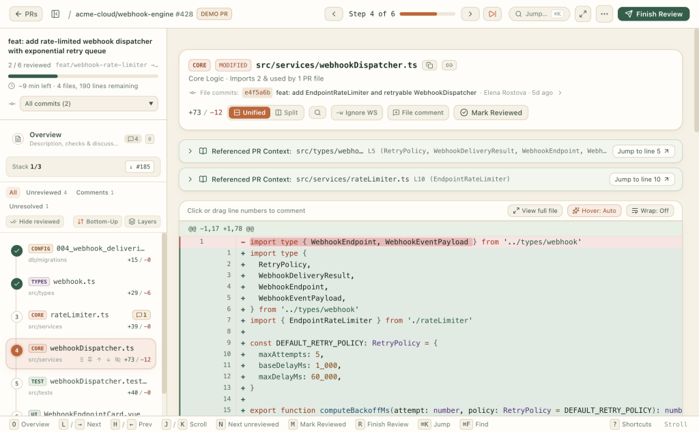
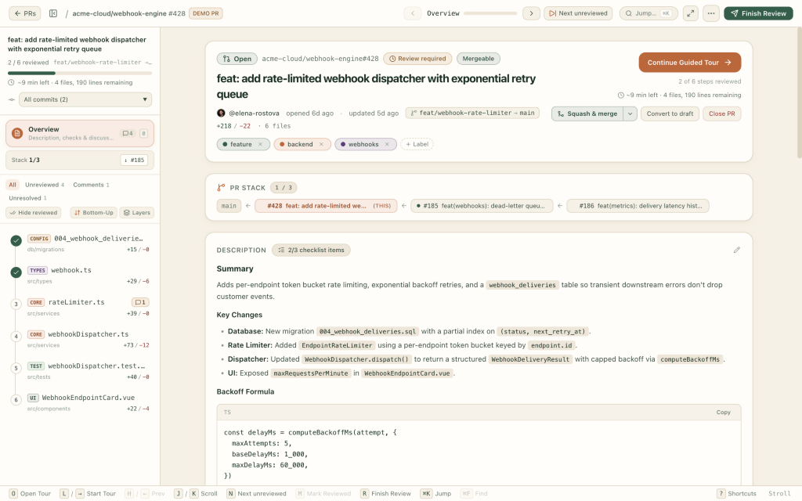
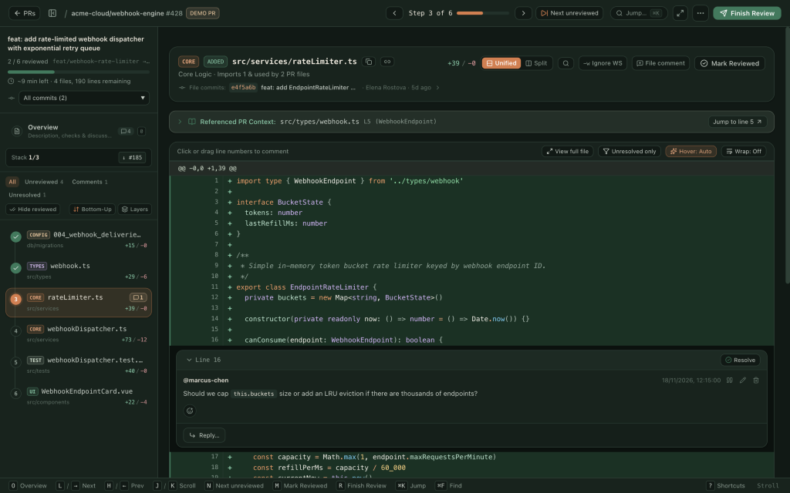

<h1>
  
  Stroll — Guided Code Review
</h1>

A cross-platform desktop application built with **Tauri v2**, **Vue 3**, **TypeScript**, **Pinia**, **Tailwind CSS v4**, and **CodeMirror 6** for reviewing GitHub Pull Requests as a guided, dependency-aware tour instead of a flat alphabetical file list.

## Screenshots

### Guided Diff Tour (Light Theme)
Dependency-ordered tour sidebar (`CONFIG` → `TYPES` → `CORE` → `TEST` → `UI`), **Referenced PR Context** cards, and isolated CodeMirror 6 diff viewer.



### PR Overview
PR summary, stack chain, description, checks, commits, and review progress at a glance.



### Dark Mode & Inline Review Threads
**Deep Pine Dark** theme with inline review threads, emoji reactions, and resolution controls.



## Features

- **Guided Reading Order Engine**: Classifies changed files into architectural layers (`config`, `types`, `core`, `ui`, `tests`), parses relative, `@/`, Python, and C# (`using`/namespace) imports to topologically sort dependencies before consumers (`Bottom-Up` or `Top-Down`), and pairs test files immediately after their implementation.
- **PR Inbox & Overview**: Browse open PRs filtered by **Review Requested**, **My PRs**, or **All Involved** (with optional auto-refresh and desktop notifications), or load any PR by URL. Includes a dedicated PR Overview with description, checks, commits, labels, reviewers, and conversation.
- **Isolated Single-File Diff Viewer**: Syntax-highlighted diffs via CodeMirror 6 with collapsible unchanged sections, in-diff search (`Cmd/Ctrl + F`), and **Referenced PR Context** cards for modified types and functions imported from other files in the same PR.
- **Local Repo & AST Code Intelligence**: Link local Git repositories in Settings to enable Tree-sitter symbol resolution (TypeScript, JavaScript, Rust, Python, C#) and `git blame` context directly in code hover popovers.
- **End-to-End GitHub Review Flow**: Add inline draft comments persisted locally, reply to or edit review threads, add emoji reactions, and submit `APPROVE`, `REQUEST_CHANGES`, or `COMMENT` reviews via GitHub GraphQL. Supports both `github.com` and custom GitHub Enterprise hosts.
- **Flexible Authentication & Demo Mode**: Sign in via the GitHub CLI (`gh`) or a Personal Access Token stored in your OS keychain, or explore the built-in offline demo PR without credentials.
- **Command Palette & Themes**: Jump to files, symbols, review threads, or the overview with `Cmd/Ctrl + K`, and switch between Light, Dark, and System themes in Settings (`Cmd/Ctrl + ,`).

## Keyboard Shortcuts

| Shortcut | Action |
| --- | --- |
| `O` / `0` | Toggle / Open PR Overview |
| `L` / `→` | Next step |
| `H` / `←` | Previous step |
| `J` / `↓` | Scroll down |
| `K` / `↑` | Scroll up |
| `M` | Mark current step reviewed |
| `[` | Toggle tour sidebar |
| `R` | Finish review |
| `Cmd/Ctrl + K` | Open command palette |
| `Cmd/Ctrl + F` | Search within current diff |
| `Cmd/Ctrl + ,` | Open settings |
| `Esc` | Close active modal, palette, or search |

## Prerequisites

- [Bun](https://bun.sh/) (latest) — used as the JS/TS runtime and package manager
- [Rust & Cargo](https://rustup.rs/) — required for Tauri v2 desktop builds
- [GitHub CLI (`gh`)](https://cli.github.com/) *(optional)* — for one-click GitHub authentication

## Getting Started

```bash
bun install                                        # Install dependencies
bun run test                                       # Run Vitest unit tests
bun run build                                      # Type-check (vue-tsc) + Vite production build
bun run dev                                        # Start Vite dev server (browser mode)
bun run tauri dev                                  # Launch the Tauri v2 desktop app
cargo check --manifest-path src-tauri/Cargo.toml   # Verify Rust backend compiles
```

## Architecture

- **`src/services/`**: Core TypeScript logic — GitHub GraphQL/REST client (`github.ts`), reading-order topological sorter (`readingOrder.ts`), diff parser (`diffParser.ts`), symbol/code context engine (`codeContext.ts`), and Tauri/browser storage & HTTP wrappers (`storage.ts`, `http.ts`, `native.ts`).
- **`src/stores/`**: Pinia Composition API stores (`auth.ts`, `review.ts`, `settings.ts`).
- **`src/components/`**: Vue 3 (`<script setup lang="ts">`) UI components.
- **`src-tauri/`**: Tauri v2 Rust backend providing OS keychain integration (`keychain.rs`), `gh` CLI token lookup (`gh.rs`), local `git` blob/blame inspection (`git.rs`), and Tree-sitter AST symbol resolution (`ast.rs`).

## License

[MIT](LICENSE) © totalfreak
